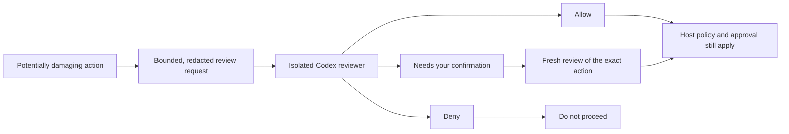

<!-- Hallmark · pre-emit critique: P5 H5 E4 S5 R4 V4 -->

# Codex Permission Reviewer

[](https://github.com/adriancho91s/codex-permission-reviewer/releases/latest)
[](https://github.com/adriancho91s/codex-permission-reviewer/actions/workflows/ci.yml)
[](LICENSE)

A small second opinion for actions that could cause meaningful damage or data
loss. Routine commits, ordinary pushes, pull requests, CI, narrow edits, and
read-only work stay in your usual Codex flow.

**Advisory only:** it never runs the proposed action or grants permission.
Codex and your host's approval rules remain in control.

## Install

Requires **Node.js 20+** and **Codex 0.147+**.

```sh
npx -y github:adriancho91s/codex-permission-reviewer#v0.4.0 install
```

Start a new Codex thread after installation so it loads the skill and MCP tool.

## How it works

The bundled skill asks the local MCP tool to review bounded, redacted action
details when a meaningful risk is present. The isolated reviewer returns advice;
Codex still applies its own policy and asks you to approve when required. This
is separate from Codex's general code-review workflow.



| Situation | What to expect |
| --- | --- |
| Routine, reversible work | Keep working without extra review just because the task uses a network or external service. |
| Exact sensitive action | Targeted deletion, a production-data change, deployment, or an access-control change may need review. If you already authorized that exact action in this conversation, Codex can request a fresh review with that context. |
| Broad, ambiguous, denied, or unavailable review | The action remains unapproved. A reviewer failure never becomes an allow. |

Human confirmation is meaningful, but it is not a bypass: a model denial or
`needs_user` verdict stays effective, and the host remains the final authority.

## Other install options

The source installer adds the bundled permission-review skill to your
`CODEX_HOME` and registers a version-pinned local MCP command. It does not
replace differing skill content unless you rerun it with `--force` after
reviewing the change.

<details>
<summary>Marketplace, release archive, and MCP details</summary>

Codex can install from a configured marketplace snapshot:

```sh
codex plugin add codex-permission-reviewer@YOUR_MARKETPLACE
```

Each [GitHub Release](https://github.com/adriancho91s/codex-permission-reviewer/releases)
also includes a prebuilt `.tgz` archive for local or offline installation. The
archive is built and tested from the same versioned source tag. Releases are
hosted on GitHub; the package is not published to the npm registry.

The MCP command registered by the installer is:

```sh
npx -y github:adriancho91s/codex-permission-reviewer#v0.4.0 mcp
```

The launcher uses the relative path `./scripts/server.mjs` with `cwd: "."` so
Codex resolves it from each installed plugin root, not a machine-specific path.

</details>

## Trust and privacy

- **You stay in control.** An `allow` is advice, not a host permission. It does
  not change the Codex sandbox, bypass an approval prompt, or suppress the host's
  own review. The host checks policy and approval again at execution time.
- **No action execution.** The plugin reviews; it never runs the proposed
  command or performs the requested operation.
- **No credential handling by the plugin.** The local MCP uses your existing
  managed Codex login. The child receives an OS-level symlink to the managed
  `auth.json`; the plugin never opens, copies, logs, or stores that file or an
  API key.
- **Minimal approval memory.** Eligible approvals retain only a versioned hash
  of the exact action scope and timestamps for 30 days. Raw commands, targets,
  reasons, data, and secrets are not stored.

<details>
<summary>Confirmation rules and what cannot be approved</summary>

Without exact current authorization or a matching, eligible, unexpired learned
approval, only a verified narrow regular-file read can be automatically
allowed, and only after trusted-root and filesystem checks. Sensitive actions
can require fresh confirmation and a new review of the exact scope. Some risks
remain blocked or require fresh review, including force pushes and unleased
history rewrites, broad destructive SQL, broad or recursive filesystem
operations, authorization bypass, ambiguous targets, and download-and-execute
pipelines. Destructive actions are excluded from approval learning and require
fresh review.

The plugin is a bounded advisory layer, not a shell or SQL interpreter. It
recognizes common command patterns, but cannot resolve every alias, variable,
generated program, or dialect. Absence of a detected pattern does not itself
approve an action. See [architecture and classifier limits](docs/architecture.md).

</details>

## Optional setup

The default reviewer is `gpt-5.6-luna` at `max` effort. To choose another
supported Codex model and effort, reinstall the MCP entry:

```sh
npx -y github:adriancho91s/codex-permission-reviewer#v0.4.0 install --force \
  --model MODEL_ID --effort max
```

The selected model ID and effort are the only customization values saved in MCP
configuration. The reviewer response is checked against both before its verdict
is accepted.

For automatic `allow`, configure trusted workspace roots outside the
repository and marketplace files:

```sh
export KIT_CODEX_AUTO_PERMISSION_WORKSPACE_ROOTS="/absolute/path/to/workspace"
```

Request-supplied roots are untrusted. Without a trusted server-side root, a
reviewer `allow` becomes `needs_user`.

<details>
<summary>Account, team setup, and availability</summary>

The parent Codex installation needs a regular `auth.json` in its managed
Codex home. The child runs with that user's managed login, subscription usage,
and authorization boundary; there is no separate API integration or billing
path. The plugin does not read the authentication file. Each teammate signs in
to their own managed account and configures their own trusted workspace roots.

For workspace distribution, an admin can publish from ChatGPT
**Plugins → Personal → Publish**, review the package and local MCP boundary,
and choose installation and role access. Publishing does not install the
package or assign it to roles by itself.

Busy, timeout, or child-availability failures return `needs_user` with
`reviewStatus: "unavailable"`; they never grant permission. A caller may retry
the review query once within its remaining budget while the sensitive action
waits. Missing auth needs setup help. Malformed output and policy denials remain
distinct from availability failures; malformed output or isolation mismatches
fail closed.

</details>

## For contributors

Source is strict TypeScript under `src/`; `scripts/` keeps installed launcher
paths stable. Tests use fixtures and temporary state, never proposed destructive
commands or live reviewer calls. Start with [contributing](CONTRIBUTING.md),
the [maintenance map](docs/maintenance.md), and the
[architecture guide](docs/architecture.md). See [release and install details](docs/releases.md)
and the [TypeScript build contract](docs/typescript.md).

```sh
npm ci
npm run check
npm test
npm run test:package
npm pack --dry-run
```
