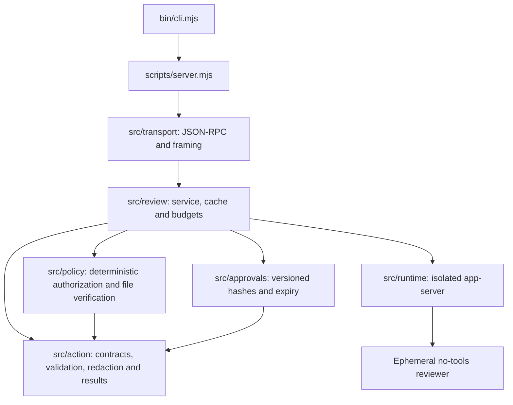

# Reviewer architecture

The runtime separates untrusted metadata, deterministic policy, local approval
state, model execution, orchestration, and MCP I/O. Stable files in scripts/
preserve installed plugin paths and the existing import API. Runtime dependencies remain Node built-ins; strict TypeScript is compiled during
development/packaging, so consumers need no build tools.

Shared limits live in src/config.ts. Model/effort configuration is a leaf module
in src/runtime/config.ts, so loading contracts does not load process-launch code.
The action and policy domains do not depend on orchestration or transport.
Architecture tests reject cycles and imports outside these boundaries.

## Ownership and entrypoints

| Path | Owns |
| --- | --- |
| src/action/ | Action schemas, normalization, secret checks/redaction, prompts, canonical digests, model response validation |
| src/policy/ | Command signals, exact authorization blockers, learned-approval eligibility, trusted-root and file-identity checks |
| src/approvals/ | Expiring, versioned action hashes and timestamps; no raw metadata |
| src/review/ | Model call composition, concurrency/rate limits, result caching, cancellation and policy application |
| src/runtime/ | Validated model configuration, executable identity, isolated child configuration/environment, protocol and cleanup |
| src/transport/ | MCP lifecycle, bounded lines, cancellation routing and JSON-RPC output |
| scripts/ | Compatibility exports/launcher and local syntax check |
| bin/ | CLI installation and MCP process launch |

Every maintained directory has an AGENTS.md with its contract. New domains and
subfolders need their own specification. npm includes src/ so both the CLI and
plugin launcher work from a packaged install. No installer configuration, running
plugin, managed credentials, release tag, or published version is changed.

## Decision flow

1. Validate and normalize metadata, rejecting unsupported fields, raw secrets,
   missing scope, and oversized inputs. Compute the canonical action digest.
2. Reject cancellation before consulting learned approvals or result cache.
3. Consult eligible exact learned approvals; corrupt or unavailable state never
   grants permission. Explicit requests always require a fresh model review.
4. Reverify cached safe reads against current filesystem state. Otherwise queue
   bounded work behind one active child, recheck reuse after waiting, enforce the
   rolling model-call budget, and call the managed isolated reviewer. A request's
   deadline covers reuse, queue wait, auth, model work and policy checks.
5. Strictly validate the complete response. Preserve deny and needs_user, including after
   explicit user authorization. Apply deterministic restrictions to model allow.
6. Decorate the advisory result with its digest and timestamps. Persist only
   eligible successful explicit approvals, using hashes and timestamps.

The default service uses the real runtime. createReviewService accepts trusted
in-process adapters so tests can return controlled model responses without a
live Codex child or authentication. MCP metadata cannot inject these adapters.

## PR #2 review and expanded regression scope

PR #2 at `3f9a6c222c1e9000e439b3cff146ab8ba00646cd` correctly prevents the
reported Docker --rm option from matching the rm branch. Its original 16 fixtures
pass. No defect introduced by that one-line change was found. It is a valid
narrow correction to issue #1; it does not cover the wider pre-existing problems:

- Flag-order and spelling gaps: rm -fr, rm -f -r, and rm --force --recursive evade the
  old predicate. The old expression also consumes r/f in operands or later commands.
- Command boundaries: the old git expression can attribute --force from a later
  command to git push. Git global options and reordered reset flags are missed.
- SQL WHERE scope: a WHERE in another statement, string, or comment can hide a
  broad DELETE/UPDATE. Matching now scopes WHERE to a statement and ignores
  literals/comments when determining whether the qualifier exists.
- Model verdict handling: the old explicit-authorization branch replaces a valid
  model deny or needs_user with allow when deterministic blockers are absent.
  The model verdict is now preserved before explicit-authorization handling.
- Cancellation: previously an already-cancelled request could return an allow
  from cached results or learned state. Cancellation is checked before reuse.

The separate architecture PR includes the narrow correction with its original
authorship, replaces source-regex extraction with imports of production functions,
and exercises these cases at both signal and policy/service boundaries. These
are pre-existing gaps and follow-up improvements, not regressions caused by #2.

## Deliberate limits

Command matching is bounded conservative lexical analysis, not an interpreter or
a complete shell/SQL parser. It recognizes executable spellings, option tokens,
separators, absolute paths, wrappers and nested quoted strings; it does not resolve
shell variables, aliases, generated programs, eval, SQL procedures, dialect-specific
syntax, or every possible executable encoding. Inspecting nested strings can also
flag inert examples such as echo 'rm -rf path'. Absence of a signal never grants
permission: model review and other deterministic and host checks still apply.
Recursive rm is blocked even without force. A literal -- ends option parsing.

Safe-read verification and action digests are advisory snapshots. They do not
bind execution atomically or eliminate TOCTOU. The runtime adapter was relocated
without changing its isolation protocol. Tests verify composition and selected
runtime contracts, not every failure path of a real Codex app-server process.

## Validation

Run npm ci, npm run check, npm test, npm run test:package, and git diff --check. CI runs
syntax, tests, and a package dry-run on Node 20, 22, and 24. Fixture commands remain
strings; tests only launch the local MCP server with invalid metadata or use
trusted fake model adapters and temporary filesystem/approval state.

## Availability, answer completeness and human confirmation

Review coordination uses a bounded FIFO executor in src/review/scheduler.ts and
trusted runtime/storage adapters in src/review/service.ts. Four requests may
wait behind one child. Each caller owns a deadline and AbortSignal. Cancellation
removes queued work promptly; a running operation retains its slot through
cleanup even after its caller stops waiting. This prevents overlapping children.
Unrelated cached results remain usable while a model review is active.

Queued unconfirmed duplicates can reuse a completed exact-scope result instead
of spending another model call or rate token. Explicit confirmations always run
fresh. Result cache access touches LRU order without extending original expiry;
reads reverify the filesystem. Infrastructure failures are never cached.

Availability responses keep verdict=needs_user and add host-owned
reviewStatus=unavailable, retryable, and optional retryAfterMs. They do not approve
execution or claim that a model rejected the action. Missing auth is not retryable
without setup. Saturation, timeout and child failures permit a bounded retry of
the review query. Malformed output/isolation failures still fail closed. No
transparent retry, alternate model or weakened validation is used.

For completed model allows without user authorization, exact actions that have
no explicit-authorization blocker return needs_user with a fresh-confirmation
path. Non-overridable hazards and actual model denials stay effective. Human
confirmation is meaningful without becoming an unconditional policy override.

Prompts now contain all validated metadata with per-value redaction and compact
JSON, within the existing 24,000-character limit. The old builder silently
shortened commands after 4,000 characters and omitted array entries. A digest
could therefore describe more scope than the model saw. The builder now rejects
oversized complete scope and requests narrowing before spending a model call.

Coordination tests measure model-call counts and caller outcomes with fake
adapters, not real inference latency or model quality. Child isolation, model and
effort configuration, authorization boundaries, host approvals and execution-time
TOCTOU limits remain as documented.

## Typed implementation and generated launchers

All maintained application code, CLI code and tests use TypeScript with strict
checking, unchecked-index checks and explicit DTOs/adapters. Build output goes
under dist/; public declarations are packaged with the JavaScript. The existing
bin/cli.mjs and scripts/*.mjs paths are generated compatibility wrappers. They
are ignored by Git and tested from an installed archive. See typescript.md for
clean builds, npm prepare semantics and artifact validation. This migration does
not add new approval policy or runtime model behavior.
